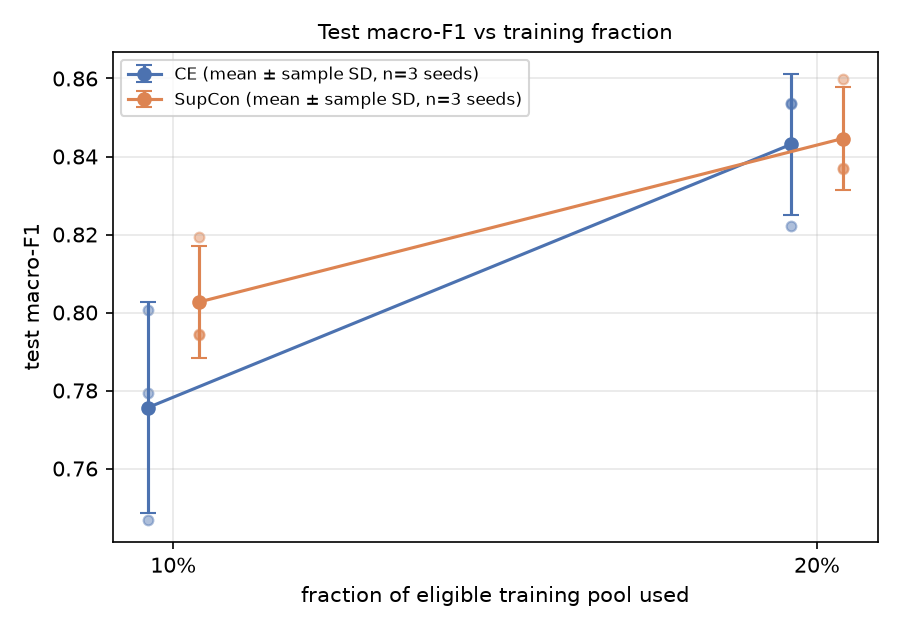
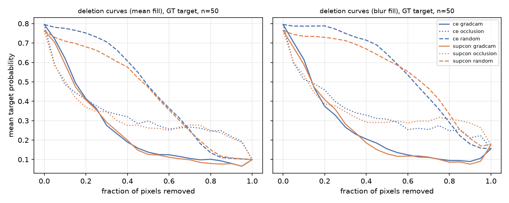
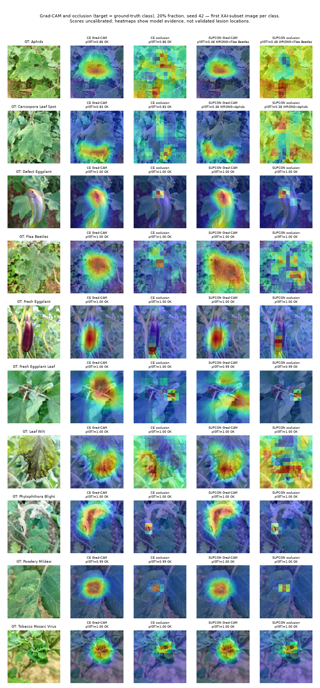
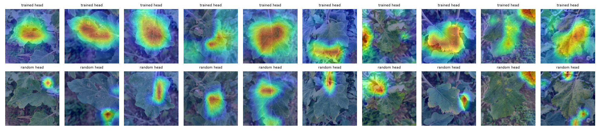
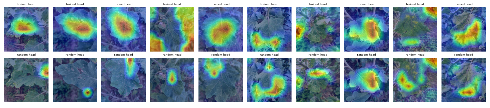
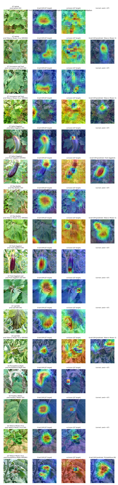
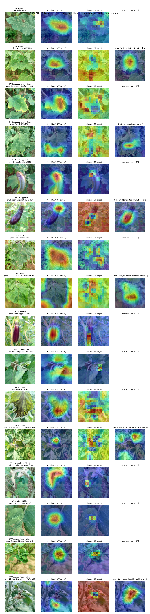

# Eggplant condition classification with few labels: cross-entropy vs supervised contrastive pretraining (EfficientNet-B0), with Grad-CAM & occlusion analysis

A small, reproducible portfolio experiment run locally (WSL2, RTX 3060 Ti 8 GB).

**Question.** When only 10% or 20% of the eligible labelled training pool is used, does a supervised-contrastive (SupCon) representation phase followed by the same cross-entropy (CE) fine-tuning improve 10-class eggplant image classification compared with a matched two-stage CE baseline? And how do the resulting Grad-CAM explanations behave under perturbation?

**What this is / is not.** This is *low-resource supervised transfer learning*: reduced training fractions on the **same 10 classes** at training and test time, starting from ImageNet weights. It is **not** few-shot / episodic meta-learning with fixed shots or unseen classes. SupCon improving results was a hypothesis, not an assumption. Negative and inconclusive outcomes are reported as they came out.

## Results (all 12 pipelines completed; final evaluation on the locked 450-image test split)

**Bottom line.** SupCon → CE was higher on average at the 10% budget: +0.027 test macro-F1, ahead on 2 of 3 paired seeds. At 20% it was indistinguishable from the CE baseline (+0.002, ahead on 2 of 3). With three seeds and seed-to-seed SD of 0.013–0.027, **this is suggestive at 10% and null at 20%, not an established improvement.**

| method | fraction (realized) | test macro-F1, mean ± sample SD (n = 3) | accuracy | balanced accuracy |
|---|---|---|---|---|
| CE two-stage | 10% (203 img) | 0.776 ± 0.027 | 0.827 ± 0.020 | 0.771 ± 0.014 |
| SupCon → CE | 10% (203 img) | **0.803 ± 0.015** | 0.843 ± 0.009 | 0.790 ± 0.013 |
| CE two-stage | 20% (412 img) | 0.843 ± 0.018 | 0.879 ± 0.015 | 0.825 ± 0.021 |
| SupCon → CE | 20% (412 img) | 0.845 ± 0.013 | 0.882 ± 0.016 | 0.829 ± 0.017 |

Paired SupCon − CE test macro-F1 for each seed:

| fraction | seed 17 | seed 42 | seed 2026 | mean (SD) |
|---|---|---|---|---|
| 10% | −0.006 | +0.048 | +0.040 | +0.027 (0.029) |
| 20% | −0.017 | +0.015 | +0.006 | +0.002 (0.016) |

The seeds vary the training subset, the data order and the augmentations under **one fixed split**. The SD describes that variability only. It is not a confidence interval for new farms, devices or datasets, and with n = 3 no significance test is claimed.



**Compute (identical per pair).** 10%: 585 optimizer updates and 15,225 image views per pipeline, ~1.2 min. 20%: 1,170 updates and 30,900 views, ~1.7–1.8 min. Peak GPU memory was 1.48 GiB (CE) and 1.51 GiB (SupCon). Validation-selected epochs fell between fine-tuning epochs 6 and 15. One SupCon run peaked at the final epoch, so a longer fine-tuning phase might have helped it; that was not tested. Full ledger: `results/run_ledger.csv`. Per-run metrics, per-image predictions with probabilities and run, support, split and checkpoint hashes: `results/metrics/`, `results/predictions/`.

### Error analysis
- **Organ is not where errors happen.** Only **2 of 768** test errors (summed over all 12 runs) cross between fruit classes (Defect/Fresh Eggplant) and leaf classes. Fruit-vs-leaf separation is essentially solved. That may rest on organ shape and background as much as on disease cues; this experiment cannot tell which.
- **Hardest classes** (mean test F1 at 20%, CE / SupCon): Powdery Mildew 0.66 / 0.67, mostly predicted as Tobacco Mosaic Virus, Aphids or Flea Beetles. Cercospora Leaf Spot 0.68 / 0.73. Aphids 0.80 / 0.78. Leaf Wilt 0.82 / 0.81, the smallest class with 13 test images. These classes are all diseased leaves with spots, holes or mottling that can look alike at 224 px.
- **Most frequent confusions across all runs:** Powdery Mildew→TMV (91), Defect↔Fresh Eggplant (70 / 68), Aphids→Flea Beetles (59). The fruit confusion is a defect-visibility problem (small or hidden defects). Note also that one image appeared under both fruit labels in the source and was quarantined, which hints at some label ambiguity there.
- At 10%, SupCon's mean gain comes mainly from Cercospora (+0.10 F1), Aphids (+0.04), Fresh Eggplant Leaf (+0.04), Leaf Wilt (+0.04) and TMV (+0.04). It is roughly even or slightly worse on Flea Beetles and Powdery Mildew (−0.01 each).
- Confusion matrices (predeclared seed 42): `results/figures/cm_*_{raw,norm}.png`. Per-class table: `results/per_class_f1_mean.csv`.

### XAI (20% fraction, seed 42, 50-image class-stratified test subset; 40/50 correct for CE, 39/50 for SupCon)

| | CE | SupCon |
|---|---|---|
| deletion AUC, Grad-CAM order, mean fill (lower = more faithful) | 0.248 | 0.240 |
| deletion AUC, random order (5 seeds), mean fill | 0.462 | 0.435 |
| images where Grad-CAM beats its own random control (mean / blur fill) | 80% / 90% | 82% / 96% |
| deletion AUC, Grad-CAM order, blur fill | 0.249 | 0.243 |
| deletion AUC, occlusion-map order, mean / blur fill | 0.328 / 0.343 | 0.316 / 0.350 |
| Grad-CAM vs occlusion: median Spearman (14×14) / mean top-20% overlap | 0.27 / 0.32 | 0.32 / 0.33 |
| sanity: median Spearman, trained vs random-head Grad-CAM | 0.03 | 0.10 |
| constant / zero Grad-CAM maps | 0 | 0 |

- For **both models**, Grad-CAM pixel rankings remove target-class evidence far faster than random rankings. The gap is about 0.20 AUC with mean fill and 0.30 with blur fill. The conclusion does not change between fills.
- **Between models** the difference is small. SupCon's Grad-CAM AUC is lower by 0.008 (mean fill) and 0.005 (blur fill), and lower on only 60% and 54% of images. Its random baseline is also lower, so relative to its own control SupCon is *not* better. **No meaningful difference in Grad-CAM faithfulness.**
- Occlusion maps (32 px patches) give a coarser ranking that beats random early in the curve but flattens after ~30% deletion. Agreement with Grad-CAM is weak to moderate. This is expected from the different resolutions and perturbation types, and it is diagnostic, not a verdict on either method.
- **Sanity check passes.** Swapping in a random classifier head almost decorrelates the maps (median ρ 0.03 / 0.10), so the explanations depend on the trained weights (`results/xai/sanity_random_head_*.png`).
- **Qualitative** (`results/xai/gallery_*.png`, one predetermined correct and one incorrect image per class). Grad-CAM mostly covers the main leaf or fruit, often its centre, rather than individual lesions. In several errors (Aphids→Flea Beetles, Leaf Wilt→TMV) the GT-target and predicted-target maps highlight the *same* region, which is consistent with confusion between similar-looking damage rather than attention to background. That is an observation, not proof. Lesion localisation is unvalidated: the dataset has no masks.



#### Grad-CAM and occlusion evidence: CE vs SupCon on the same images
Rows are predetermined: the first image of each class in the saved XAI subset, not chosen by outcome. The target is the ground-truth class for both models. In this sample, CE gets 10/10 and SupCon 8/10: Aphids→Flea Beetles and Cercospora→Aphids.



What the figure shows, without over-reading it:
- **The two models mostly highlight the same region.** On fruit it is the eggplant body or calyx. On leaves it is the main leaf blade, often its centre rather than individual spots or holes.
- **Occlusion is sharper but noisier.** It often marks a few patches inside the Grad-CAM region (Defect Eggplant calyx, Powdery Mildew, TMV). When the ground-truth probability is low (the two SupCon errors), its map is diffuse. Occlusion and Grad-CAM disagree in places; that is diagnostic, not proof that either is wrong.
- **None of this validates lesion localisation**, since the dataset has no lesion masks.

#### Sanity check: randomised classifier head
Top row: trained head. Bottom row: fixed random head. If the maps barely changed, Grad-CAM would not reflect the learned classifier. Here they change substantially: median Spearman ρ is 0.03 for CE and 0.10 for SupCon.




<details>
<summary><b>Full error galleries</b> (one predetermined correct + one incorrect image per class, where available; the incorrect rows also show Grad-CAM for the predicted class)</summary>

**CE (20%, seed 42)**



**SupCon → CE (20%, seed 42)**


</details>

Numerical XAI outputs: `results/xai/per_image_xai.csv`, `xai_summary.json`, `deletion_curves.npz`, `sanity_random_head_*.csv`. Regenerate the compact figure with `.venv/bin/python scripts/xai_evidence_figure.py` (it needs the local checkpoints).

### Limitations
- One dataset from one source and region, with image-level labels only. There is no plant, field or capture metadata, so the test set is not shown to be independent at plant level, and nothing here supports field generalisation or diagnostic use.
- The single fixed split and three seeds give low statistical power. Only one CE recipe and one SupCon recipe were tried, with no tuning. Validation labels (451) add to the development label budget.
- Softmax scores are uncalibrated. The demo cannot reject out-of-distribution images and always outputs one of the 10 labels.
- Perturbation-based XAI evaluates images that are out of distribution, and deletion AUC measures ranking faithfulness for *this* model, not biological correctness.

## Data

- **Source.** *Eggplant Dataset: A Comprehensive Dataset for Agricultural Research and Disease Detection*, Mendeley Data **v1**, DOI [10.17632/5drkk544k8.1](https://data.mendeley.com/datasets/5drkk544k8/1), published 2024-07-10, by Nirob, Bishshash, Ayan, Khatun & Uddin (Daffodil International University / Jahangirnagar University). License **CC BY 4.0**. Dataset paper: [A comprehensive annotated image dataset for deep learning analysis of eggplant leaf diseases](https://pmc.ncbi.nlm.nih.gov/articles/PMC12552563/). Images are used unmodified (resized copies in a local cache only). No endorsement by the authors is implied.
- **Only `Original Dataset.zip` is used.** The separate 10,000-image *Augmented Dataset* is never downloaded or used. The archive's SHA-256 (`9f2a67e6…5839`) was verified against the value the Mendeley API publishes.
- **Task as it actually is.** The 10 classes mix **leaves and fruits**, healthy and diseased, and include pest damage: Aphids, Cercospora Leaf Spot, Defect Eggplant (fruit), Flea Beetles, Fresh Eggplant (fruit), Fresh Eggplant Leaf, Leaf Wilt, Phytophthora Blight, Powdery Mildew, Tobacco Mosaic Virus. Organ (fruit vs leaf) and background are therefore possible shortcuts. The class map is in `data/manifests/class_map.json`; class IDs are the alphabetical order of the folder names.
- **Annotation type.** Image-level class labels only. There are no lesion masks, bounding boxes, or plant/field/capture metadata.

### Audit (before any split)
`python -m eggplant audit` builds `data/manifests/image_manifest.csv`. Each row records the relative path, source/version, original label, class ID, raw and EXIF-corrected size, file SHA-256, decoded-pixel SHA-256, decode status, pHash, duplicate group, group type and provenance, and exclusion reason.

| check | observed |
|---|---|
| images in archive | **3,116** JPG (source states 3,116) in 10 folders; no non-image files |
| decode failures / empty files | 0 / 0 |
| size / mode / EXIF orientation | all 800×800, RGB, orientation tag 1 |
| exact duplicates (bytes or decoded pixels) | **128 pairs, all inside "Fresh Eggplant Leaf"** (256 files → 128 unique) |
| near-duplicates (pHash Hamming ≤ 4, incl. flips/rotations) | 47 pairs: 46 same-label (mostly consecutive file numbers, i.e. burst shots), 1 cross-label |
| cross-label duplicate | one photo stored as both *Defect Eggplant* and *Fresh Eggplant* → both copies quarantined |
| **eligible** | **2,986 images**, 2,943 duplicate-screening groups. 130 excluded: 128 redundant exact copies + 2 conflicting-label |

All candidates were inspected on contact sheets (`data/manifests/contact_sheets/`). Byte-identical copies are not independent originals, so only the first copy (by path) is kept. Heuristic pHash groups are **kept together within one partition** for leakage safety. They are labelled as *heuristic similarity groups*, not verified specimens. **Limitation:** the source has no specimen/plant IDs. Duplicate screening cannot prove plant-level independence, and the test set should not be read as "new plants" or "new farms".

### Split and training subsets
- One fixed **group-aware, class-stratified ≈70/15/15 split** (seed 2026): train pool **2,085** images (2,064 groups), validation **451** (437), test **450** (442). Every class is present in every partition, and no group crosses partitions. `split.csv` SHA-256 `87cc8263…`.
- **Training subsets** are fractions of the *eligible training pool after* the val/test reservation and exclusions (not of the whole dataset). For each seed and class, groups are put in a seed-specific random order. The subset is the longest prefix of that order whose image count stays ≤ floor(fraction × class pool), with a minimum of one group. Because it is a prefix, **the 10% subset is contained in the 20% subset**, and both methods receive the same images. Realized size: **203 images (9.74% of pool) at 10%** and **412 (19.76%) at 20%**, the same per class for every seed. Examples: Leaf Wilt 5 / 11, Fresh Eggplant Leaf 8 / 17, Fresh Eggplant 40 / 80. Per-class counts and hashes are in `data/manifests/split_summary.json` and `supports/`.
- Unselected training-pool images are never used, whether for contrastive learning, normalisation (ImageNet statistics are used) or tuning.
- **Label budget.** Training labels are 203 or 412. Model development **also** used the 451 validation labels for checkpoint selection, so the total development annotation budget is larger than the training subset. The 450 test labels were used only in the single final evaluation.

## Protocol (controlled two-stage comparison)
Both methods start from the identical torchvision `EfficientNet_B0_Weights.IMAGENET1K_V1` encoder.

1. **Representation phase, 30 epochs.** Each batch has 16 source images × 2 independently augmented views (32 views).
   - **CE:** a temporary linear head; CE averaged over both views.
   - **SupCon:** a 2-layer projection MLP (1280→1280→128), L2-normalised, supervised contrastive loss (τ = 0.1, the *L_out* form). Positives are all same-label views, including the anchor's other view. Self-pairs are excluded and a stable log-sum-exp is used.
2. **Shared classification phase, 15 epochs.** The temporary head or projector is discarded. A **fresh linear classifier with identical initialisation for the paired runs** is attached, the optimizer and scheduler are reset, and encoder + classifier are fine-tuned with the same CE recipe (one augmented view per image). The checkpoint is selected **only in this phase**, by validation macro-F1, with ties broken by lower validation loss, then the earlier epoch.

This is a controlled *two-stage CE baseline vs SupCon → same CE fine-tuning* comparison. It is not an exhaustive comparison against every CE recipe, and not a reproduction of the SupCon paper's linear-evaluation protocol.

Shared settings: 224×224 input, ImageNet normalisation, AdamW (encoder LR 1e-4, head/projector LR 1e-3, weight decay 1e-4), per-stage cosine decay, fp16 AMP. **BatchNorm running statistics are frozen** (BN layers in eval mode) in both methods; BN affine parameters stay trainable. Augmentation: RandomResizedCrop (scale 0.6–1), horizontal and vertical flips, ±15° rotation, mild colour jitter. These were inspected visually (`results/figures/augmentation_preview.png`). Rotation leaves small black corners. Val/test preprocessing is deterministic: resize 224 + centre crop, applied to a cached copy with shorter side 256 (originals are 800×800).

**Pairing and determinism.** Source-image order is a function of (seed, stage, epoch). Each augmentation is a function of (seed, epoch, image, view). Heads are built under private RNG streams. As a result, CE and SupCon see identical batches and identical augmented pixels, and a resume continues the same stream at the epoch boundary. cuDNN is in deterministic mode and `CUBLAS_WORKSPACE_CONFIG` is set, but a few CUDA kernels (e.g. some backward ops) remain nondeterministic. GPU results can therefore differ at the last decimals between reruns. The CPU resume test is bit-exact.

**SupCon batch size.** The contrastive batch is 16 images = 32 views per step. There is no gradient accumulation and no memory bank. Batch 32 would fit (2.8 GiB peak in the probe), but the predeclared default of 16 was kept, so there was no batch-size sweep.

**Pilot.** A paired 10%/seed-42 pilot ran before the matrix. It showed no NaNs, decreasing losses, 585 optimizer steps and 15,225 image views per run, ~1.2 min each. Nothing in the pilot justified a recipe change, so the configuration was frozen unchanged. The pilot runs have the same config-derived run IDs and are reused by the matrix. A separate smoke test (2 images/class, 2 batches) and an overfit check (20 images → 100% train accuracy) are diagnostics only, not reported runs.

## XAI methods
Predeclared models: **20% fraction, seed 42, both methods**, using the validation-selected checkpoints. The XAI subset was chosen before any model output was inspected: a deterministic, class-stratified sample of up to 5 test images per class (distinct groups first), saved to `results/xai/xai_subset.csv`.

- **Grad-CAM** on the output of the encoder's last convolutional block (1280×7×7). It runs in eval mode with gradients enabled and the hooks are removed afterwards. Maps are bilinearly upsampled to the 224×224 processed crop. Constant or zero maps are flagged.
- **Occlusion sensitivity:** 32×32 patches, stride 16 (169 perturbations). The fill is the image's own per-channel mean, applied in image space before normalisation. The map is the mean drop in target probability over the patches covering each pixel. The target class is held fixed throughout.
- **Deletion faithfulness.** Pixels are ranked by saliency and removed in 5% steps from 0 to 100%. Target = **ground-truth class for both models on every image, including errors**. Reported: the area under the target-probability curve (**lower AUC = probability falls faster = ranking more faithful**), plus a random-order control averaged over 5 fixed seeds and computed per model. Two fills are compared: channel mean and Gaussian blur (σ = 10).
- **Grad-CAM vs occlusion agreement:** Spearman correlation at 14×14 and top-20% overlap. Disagreement is treated as diagnostic, not as evidence that either method is wrong.
- **Sanity check:** the trained classifier head is replaced by a fixed random head, and the Grad-CAM change is measured (Spearman between maps).
- **Limitations.** There are no lesion masks, so **localisation accuracy is not measured and not claimed**. Masked images are out of distribution. Softmax scores are uncalibrated. Appealing heatmaps are not validation, and no human-subject study was done.

## Reproduce

```bash
# 0. environment (WSL2 Ubuntu; needs python3.12-venv: sudo apt install python3.12-venv)
bash scripts/setup_env.sh
# 1. data: verified download from Mendeley (or: bash scripts/run.sh download --local-zip "/path/Original Dataset.zip")
bash scripts/run.sh download
# 2. audit + manifest + contact sheets, 3. lock split and nested training subsets
bash scripts/run.sh audit
bash scripts/run.sh split
# 4. tests (synthetic fixtures, CPU) and smoke test / memory probe
.venv/bin/python -m pytest -q tests
bash scripts/run.sh smoke
bash scripts/run.sh smoke --batch-size 32
# 5. paired pilot, then the full matrix (resumable: just rerun the same command; completed runs are verified and skipped)
bash scripts/run.sh train --tag pilot --fractions 0.1 --seeds 42
bash scripts/run.sh train
bash scripts/run.sh ledger
# 6. final test evaluation, 7. XAI, 8. export demo checkpoints + backup bundle
bash scripts/run.sh evaluate
bash scripts/run.sh xai
bash scripts/run.sh export
# 9. local demo (CPU is fine)
.venv/bin/streamlit run app/streamlit_app.py --server.address localhost
```
### Demo app (local or Streamlit Community Cloud)
The demo runs on CPU and uses the two predeclared models (20% fraction, seed 42). Their checkpoints are committed in `app/models/` (16 MB each). The app:
- shows the CE and SupCon scores side by side. They are uncalibrated, and the app says so.
- explains any chosen class with Grad-CAM and optional occlusion.
- offers 10 bundled example images, one per class. These are the first image of each class in the predeclared XAI test subset, downscaled, and they come from the CC BY 4.0 dataset.
- accepts uploads (JPG/PNG/BMP/WEBP, EXIF-corrected) and rejects unreadable or tiny files.

It cannot reject images that are not eggplants.

**Host it on [Streamlit Community Cloud](https://share.streamlit.io):**
1. Sign in with GitHub, then choose **Create app** and **Deploy a public app from GitHub**.
2. Set **Repository** to `tanximsiam/eggplant-disease-supcon-xai`, **Branch** to `main`, and **Main file path** to `app/streamlit_app.py`.
3. Optionally, under **Advanced settings**, pick Python 3.12.
4. Choose **Deploy**.

Dependencies come from `app/requirements.txt`, which installs the CPU-only PyTorch build. Streamlit Cloud uses the requirements file next to the entrypoint before the root one, so the CUDA training stack is never installed. `bash scripts/test_app_env.sh` rebuilds exactly that environment locally and serves the app on port 8502.

Every stage prints timestamped progress and tqdm bars, and is also logged to `logs/<stage>_<time>.log`. Each run writes `runs/<run_id>/{spec.json,status.json,train.log,history.csv}`. Its checkpoints (`best.pt`, `last.pt` with optimizer/scheduler/AMP/RNG state, `encoder_after_rep.pt`) are written atomically and kept out of Git. The run ID is a hash of the method, fraction, seed, training config and split/support/class-map hashes. Resume refuses a mismatched checkpoint.

**Backup.** `exports/eggplant_results_and_checkpoints.tar.gz` holds the results, manifests, config, run metadata and every `best.pt`. Raw data, `.venv`, `runs/*/checkpoints` and `exports/` are git-ignored.

## Layout
```
configs/experiment.yaml     frozen configuration
eggplant/                   download, audit, splits, data, model, supcon, train, metrics, evaluate, xai, export, CLI (__main__)
tests/                      SupCon vs naive reference, masks/gradients, split leakage, nested supports, resume, checkpoint/class map, tiny XAI
scripts/                    setup_env.sh, run.sh (foreground runner + logs), preview_augmentations.py, xai_evidence_figure.py
app/                        Streamlit demo: streamlit_app.py, requirements.txt (CPU), models/ (2 demo checkpoints), examples/
data/manifests/             manifest, audit report, split, supports, contact sheets (committed)
results/                    ledger, metrics, predictions, figures, XAI outputs (committed)
```

## Attribution
- Dataset: Nirob et al., Mendeley Data v1, DOI 10.17632/5drkk544k8.1, CC BY 4.0.
- SupCon: Khosla et al., *Supervised Contrastive Learning*, NeurIPS 2020. The loss here is written from the paper; its structure follows [HobbitLong/SupContrast](https://github.com/HobbitLong/SupContrast) (BSD-2-Clause, © 2020 Yonglong Tian).
- Grad-CAM: Selvaraju et al., ICCV 2017. EfficientNet-B0 weights: torchvision `IMAGENET1K_V1`.
